# dotfiles

This is the terminal configuration I use.

It is open-sourced for easier install and synchronization across my machines, and can be used as a source of inspiration or starting point for your own config.

Feel free to copy it if you like it.

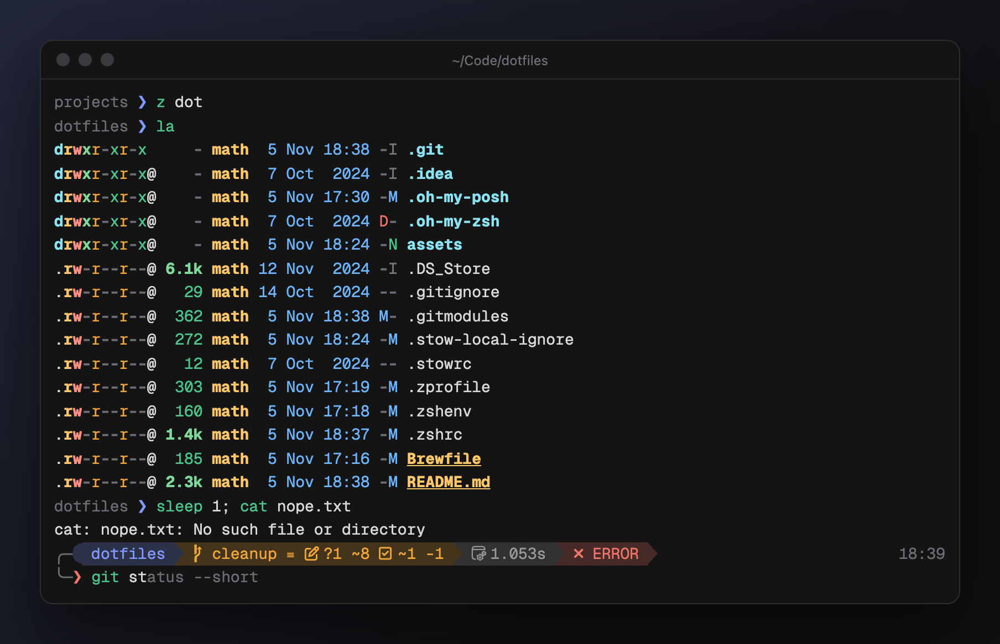

## Synchronizing dotfiles with stow

By using [stow](https://www.gnu.org/software/stow/), we can clone this repository and synchronize it with the machine's config files via symlinks.

Here are the typical installation steps on a new Mac with [Homebrew](https://brew.sh):

```sh
# Install oh-my-zsh
sh -c "$(curl -fsSL https://raw.githubusercontent.com/ohmyzsh/ohmyzsh/master/tools/install.sh)" "" --unattended

# Clone this repo (recursively with its plugins)
git clone --recursive https://github.com/mathdevie/dotfiles.git ~/Code/dotfiles
cd ~/Code/dotfiles

# Install the dependencies listed in the Brewfile
brew bundle

# Link the config into ~ thanks to stow
# (oh-my-zsh and Homebrew wrote their own .zshrc and .zprofile,
# and stow won't overwrite them, so move them away first)
mv ~/.zshrc ~/.zshrc.before-dotfiles
mv ~/.zprofile ~/.zprofile.before-dotfiles
stow .

# (Optional) Install default Node version
fnm install --lts

# (Optional) Bring your existing history into atuin
atuin import zsh
```

Then I set my terminal's font to **GeistMono Nerd Font Mono** (installed by `brew bundle`), otherwise the prompt's icons show up as boxes.

In Ghostty, add `font-family = GeistMono Nerd Font Mono` to its config. In iTerm, it's under Settings → Profiles → Text. Open a new tab and you're done.

## Secrets Management

I put tokens in `~/.secrets/zsh.env`.

This is an (obviously) uncommitted file that is loaded from the shell config (`.zshenv`).

You can create one if it doesn't exist:

```sh
mkdir -p ~/.secrets && chmod 700 ~/.secrets
echo 'export MY_TOKEN=...' >> ~/.secrets/zsh.env
chmod 600 ~/.secrets/zsh.env
```

## Default Style

Using [oh-my-posh](https://ohmyposh.dev) with a custom theme.

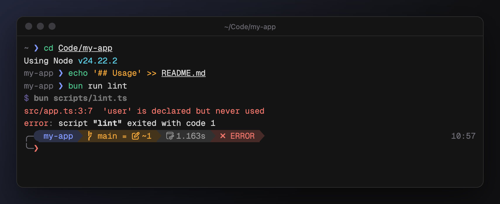

## Minimal Version

Built-in terminals (VS Code, Codfish, T3 Code, etc.) get `config-minimal.omp.json` instead: a simplified version without icons.

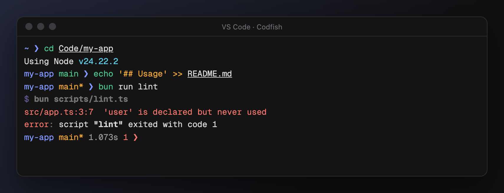

## Plugins

(Loaded through oh-my-zsh.)

### git

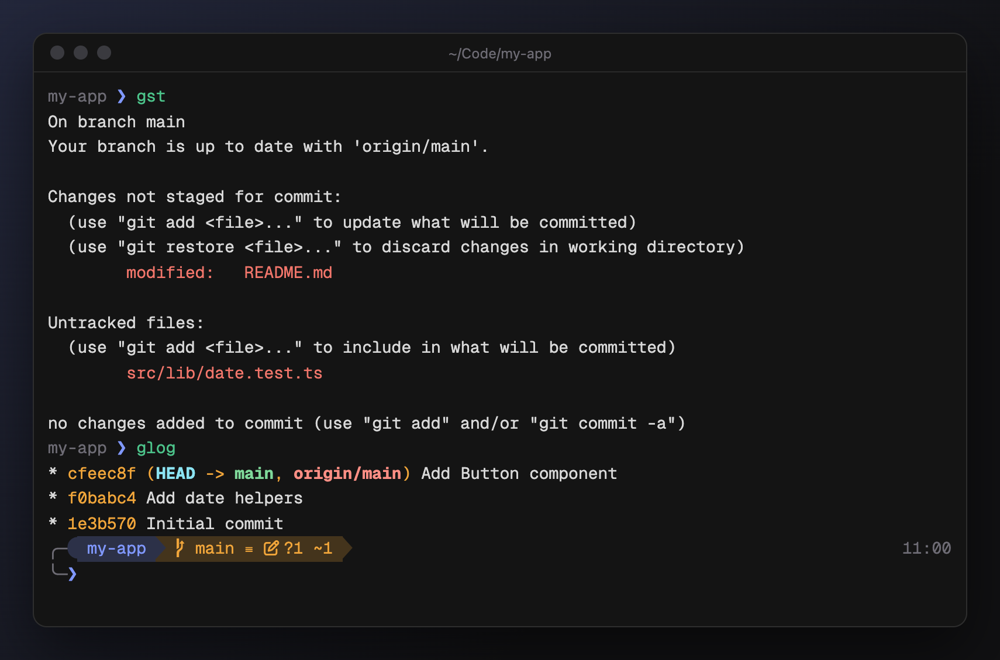

oh-my-zsh's git aliases for convenience: `gst` (status), `glog` (compact history graph), `gco` (checkout), `gcm` (back to main), `gp` (push), `gl` (pull). `alias | grep git` lists them all.

### zsh-autosuggestions

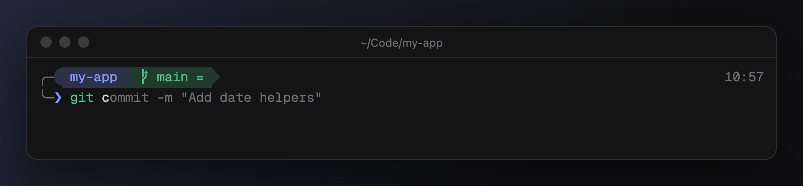

Suggests the rest of the command in gray, from your history. Press "→" to accept it.

### zsh-syntax-highlighting

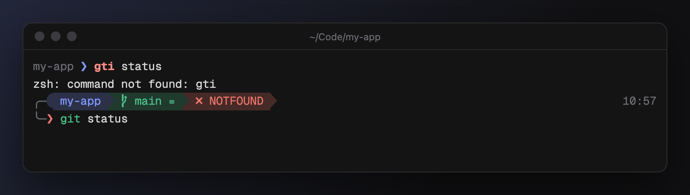

Colors the command while you type it: green if it exists, red if it doesn't. You catch typos like `gti` before pressing Enter.

## Tools

(Extra tools, listed in the Brewfile. `Ctrl` is the Control key (⌃), also on a Mac.)

### atuin

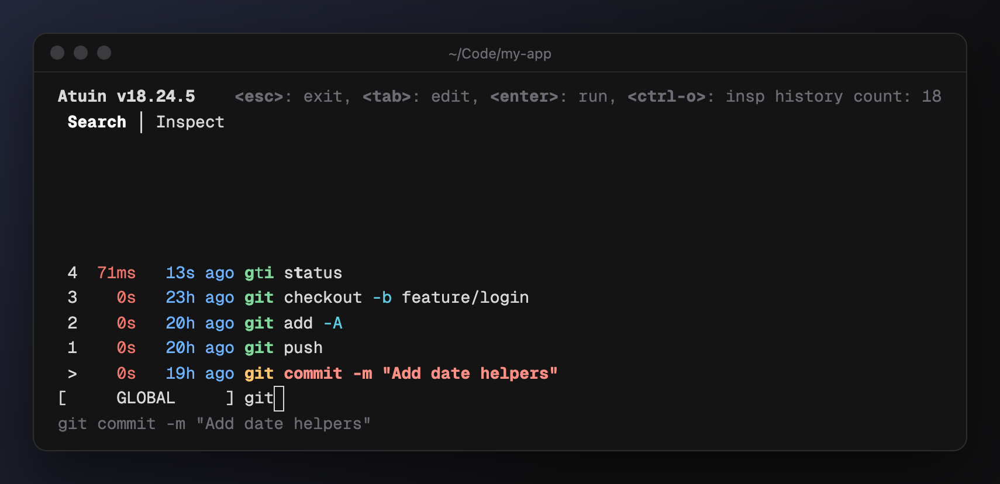

`Ctrl-R` opens a search over your history. Type any part of a command, `Enter` runs it, `Tab` puts it on the command line so you can edit it first. Press `Ctrl-R` again to narrow the search to the current session or folder. The up arrow still works as usual.

### zoxide

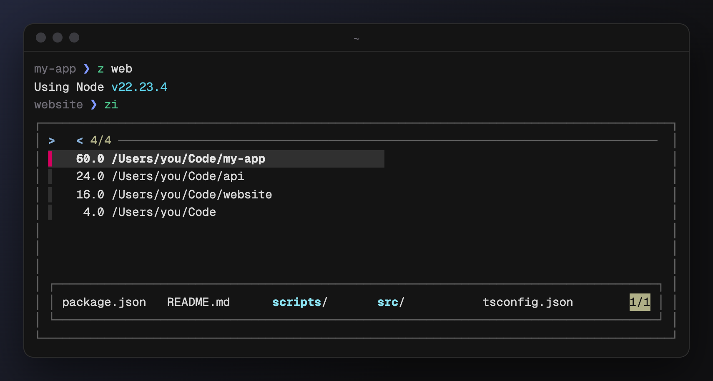

Learns which folders you use. `z web` jumps to the best match for "web" from anywhere, `z -` goes back. `zi` opens a picker with a preview of each folder.

### eza

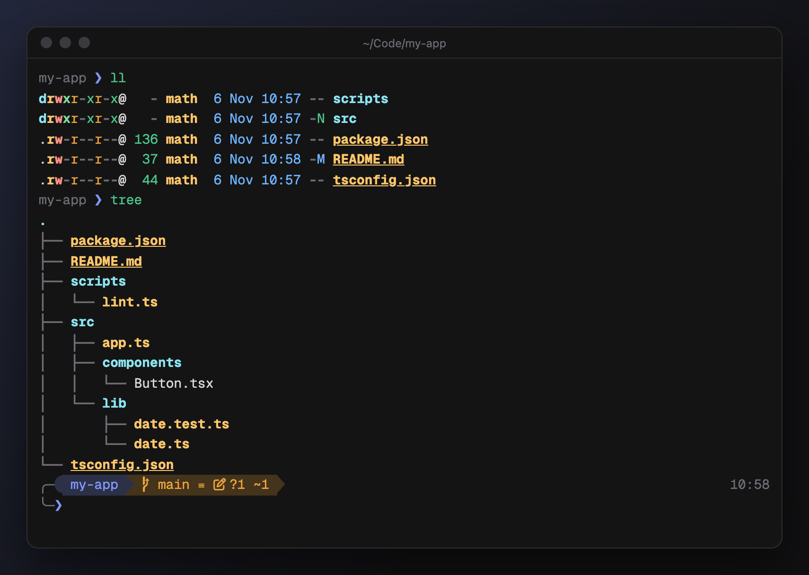

Replaces `ls`. `ll` and `la` add a git column (`M` modified, `N` new), `la` also shows hidden files, and `tree` skips anything in `.gitignore`.

### fzf

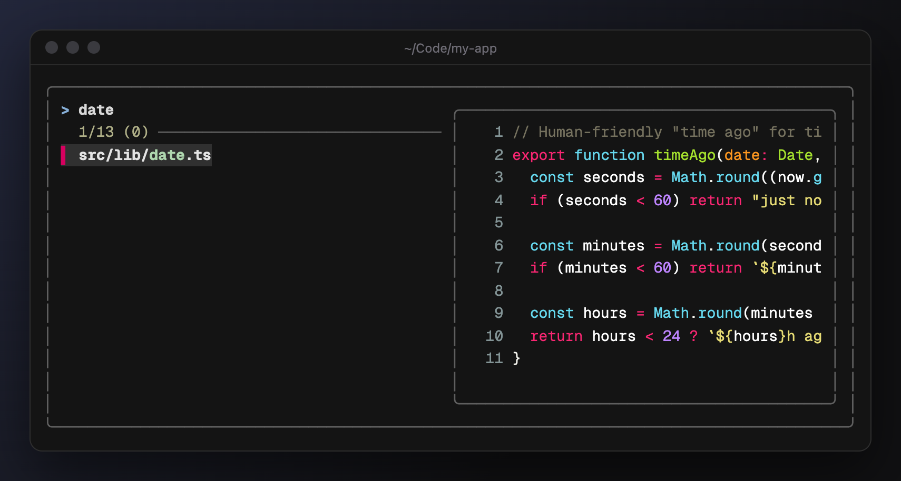

`Ctrl-T` fuzzy-finds a file, shows a preview, and pastes its path into the command. Typing `**` then Tab opens the same picker in the middle of a command, for example `cd **` + Tab.

### bat

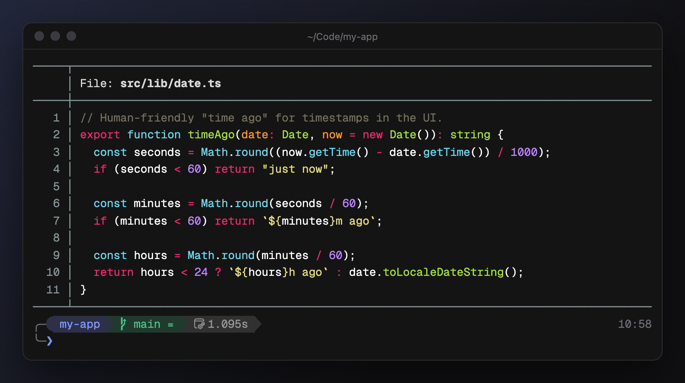

`cat` with syntax highlighting and line numbers. In a git repo it also marks changed lines in the margin. It's a separate command, so `cat` itself behaves as usual.

### direnv

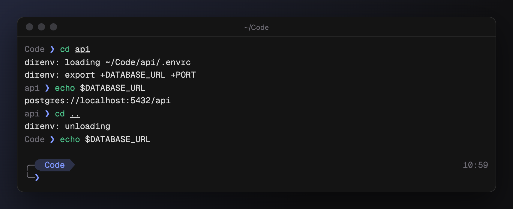

Loads a folder's `.envrc` when you enter it and unloads it when you leave, so one project's settings never leak into another. Run `direnv allow` once per folder, and again after editing `.envrc`.

### fnm

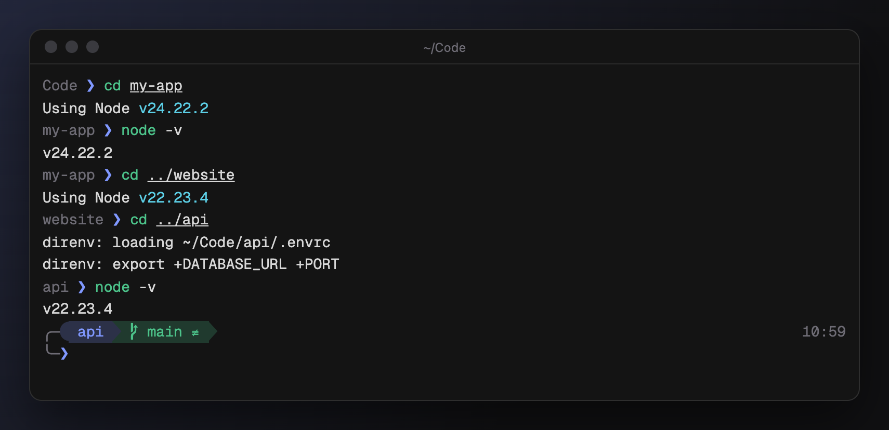

Switches Node version on `cd` based on `.nvmrc` or `.node-version`, and goes back to your default outside projects.
It is preferred over nvm as it loads much faster in new terminal windows.

### Other

The Brewfile also has `ripgrep` (`rg`, a faster grep), `gh` (GitHub from the terminal) and `bun`.

## Cheat sheet: Main commands

| Keys or command | Does |
| --- | --- |
| `→` | Accept the gray suggestion |
| `Ctrl-R` | Search history |
| `Ctrl-T` | Insert a file path |
| `z <name>`, `zi` | Jump to a folder |
| `ll`, `la`, `tree` | List files |
| `gst`, `gco`, `gp`, `gl` | git status, checkout, push, pull |

## Cheat sheet: Main files

| File | Purpose |
| --- | --- |
| `.zshenv` | Config for every shell. Loads the secrets. |
| `.zprofile` | Config for new terminal tabs. Homebrew and PATH. |
| `.zshrc` | Config for interactive shells. Plugins, theme and tools. |
| `.oh-my-posh/` | The themes and customizations. |